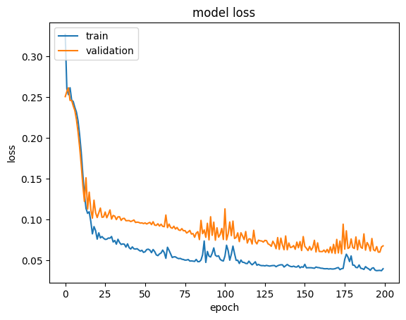

<div align="center">

# Violence Detection — Hockey Fights

### Spotting fights in video with transfer learning: VGG16 frames → LSTM sequence model


[How it works](#how-it-works) ·
[Results](#results) ·
[Dataset](#dataset) ·
[Run it](#run-it)

</div>

---

A video is just a sequence of frames, and a fight is a pattern *across* those
frames — not something any single frame can prove. This project pairs a
pre-trained image network with a recurrent one to classify short hockey clips
as **fight** or **no fight**: VGG16 turns each frame into a feature vector, and
an LSTM reads the sequence of vectors to make the call.

<p align="center">

</p>

## How it works

The pipeline is classic **transfer learning + sequence modelling**, built in the
[`violence-detection.ipynb`](violence-detection.ipynb) notebook:

```
clip ──▶ sample 20 frames ──▶ VGG16 (frozen) ──▶ 20 × 4096 transfer values
                                                        │
                                            cached to disk (slow step, done once)
                                                        │
                                                        ▼
                                      LSTM ──▶ Dense ──▶ softmax ──▶ {fight, no-fight}
```

1. **Sample.** 20 evenly spaced frames are pulled from each clip and resized to
   224×224 — the input size VGG16 expects.
2. **Extract features.** Each frame passes through VGG16 (ImageNet weights),
   producing a 4096-dim *transfer value*. These are cached to disk so the
   expensive CNN pass runs only once.
3. **Model the sequence.** The 20×4096 sequence feeds an LSTM followed by dense
   layers and a 2-way softmax. If violence appears anywhere in the sequence,
   the clip is labelled a fight.

## Results

The LSTM reaches roughly **96% validation accuracy** on a held-out 20% of the
clips. Accuracy/loss curves and sample predictions are at the end of the
notebook.

<p align="center">


</p>

> Accuracy is reported on this dataset's own split. This is a learning project,
> not a benchmarked production detector.

## Dataset

The **Hockey Fight** dataset — 1,000 short clips (`fiXXX` = fight,
`noXXX` = no fight) — lives in [`data/`](data/). The clips are small `.avi`
files, so the repo is self-contained and the notebook runs end to end after
cloning.

## Run it

```bash
git clone https://github.com/harshakalluri1403/Violence-Detection.git
cd Violence-Detection

# a virtual environment is recommended
python -m venv venv && source venv/bin/activate   # Windows: venv\Scripts\activate
pip install tensorflow opencv-python numpy matplotlib h5py

jupyter notebook violence-detection.ipynb
```

Then run the cells top to bottom. The first full pass caches VGG16 transfer
values to disk; later runs reuse the cache and are much faster.

## Tech stack

TensorFlow / Keras · VGG16 (transfer learning) · LSTM · OpenCV · NumPy ·
Matplotlib · Jupyter
